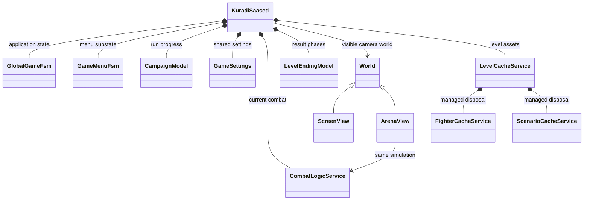
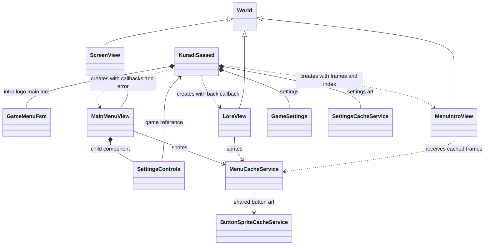
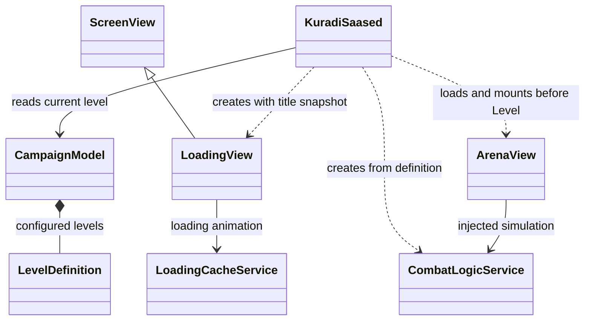
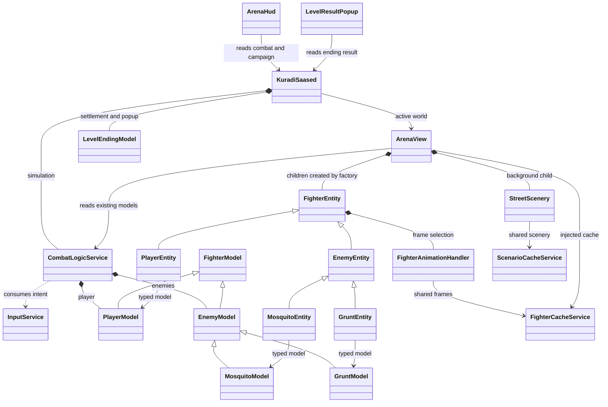
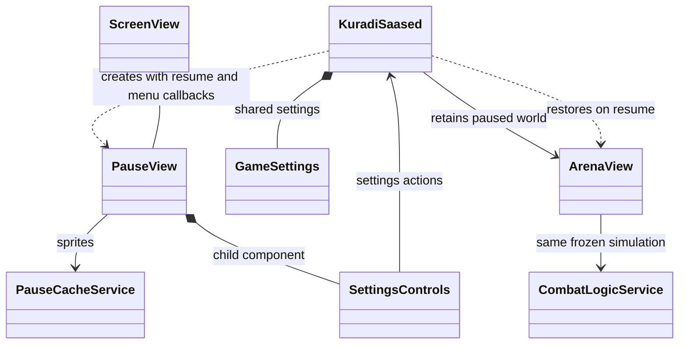
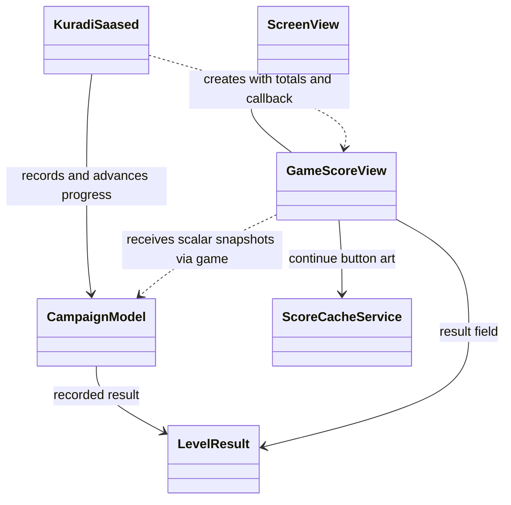
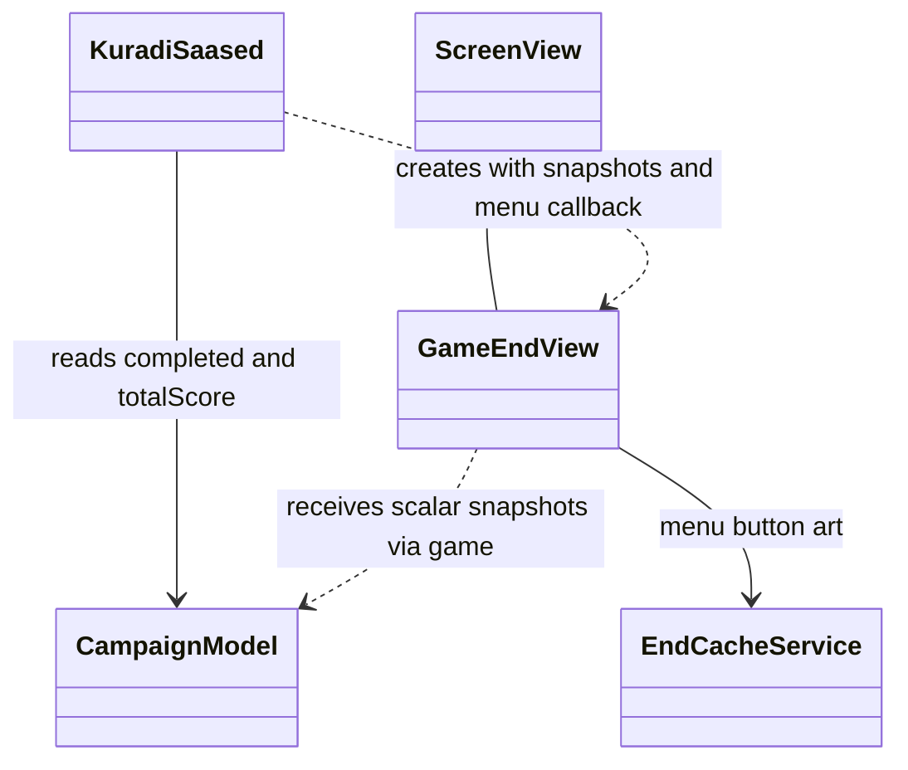

# Application UML: views and models in every state

These diagrams describe the implemented app. Select a state in the
[interactive browser page](../web/app-architecture.html) to inspect its views,
models and asset services. With the web game running, open
`app-architecture.html` beside its index page.

`*--` means lifecycle ownership, `-->` a held reference, `..>` a dependency or
value passed during construction, and `<|--` inheritance. A screen does not
automatically have its own model: several receive values and callbacks from the
game. Dashed arrows explicitly distinguish these snapshots from model fields.

## Application ownership

The game composes the application. State entry selects the visible Flame World.
Campaign/settings survive world changes; combat is replaced on level loading.
Pause retains the current arena and combat. Asset services last for the game
instance. The game owns LevelCacheService, which manages fighter/scenario caches.

## Menu

Menu contains Intro, Logo, Main and Lore substates. Intro/Logo use the same view
class with a different frame index. MainMenuView receives callbacks, a loading
error value and settings controls; it has no dedicated MainMenuModel. Settings
controls reach shared settings and their cache through the game.

## Loading

LoadingView gets a description string and LoadingCacheService. The game reads
the campaign's current LevelDefinition, creates combat and mounts the next arena
off-camera before entering Level. LoadingView does not construct those models.

## Arena / Level

ArenaView holds combat and shared caches. Each entity references the exact model
updated by combat. Its handler selects frames from state/time. ArenaHud and
LevelResultPopup are camera viewport children, not ArenaView children; both hold
the game and read the relevant state through it. Animations cannot change rules.

The detailed [fighter UML](fighter-arena-uml.md) expands each concrete animation
handler and its typed model contract.

## Pause

PauseView receives callbacks and SettingsControls. It does not contain combat or
copy fighter models. KuradiSaased retains the existing ArenaView and simulation,
stops combat updates, and restores that same world on resume.

## Score

CampaignModel records one LevelResult per encounter. GameScoreView holds that
result and scalar snapshots for totals, level numbers and next-level status.
It does not hold CampaignModel directly. Continue calls the game, which advances
the campaign and selects Loading or End. The old arena reference is cleared.

## End

GameEndView receives completion and score snapshots plus a menu callback. There
is no EndModel and no direct CampaignModel field. The campaign remains owned
by the game; a new run resets it when the player starts from Menu.

## Regenerating the browser diagram

Run `node tool/render_app_architecture.mjs build/pele-1.6.0.mjs` from the project
root, or supply another local path to Pele 1.6.0. The generator embeds SVGs,
Mermaid source and the existing retro font into `web/app-architecture.html`.
The output works offline and ships beside the web game on the next web build.
