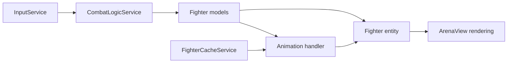

# Building and extending Kuradi Sääsed

This is the development contract for future changes: where code belongs, what
to reuse, and when a new class has a purpose. It describes the current structure
and marks future extension points explicitly. Read it before adding a character,
animation, level, screen, or asset service.

Use [architecture.md](architecture.md) for runtime details,
[app-architecture-uml.md](app-architecture-uml.md) for each state's view/model connections,
[fighter-arena-uml.md](fighter-arena-uml.md) for the implemented relationships,
and [ASSETS.md](../resources/ASSETS.md) for sheet layouts and pixel preparation.
Update those documents when their corresponding decisions change.

## 1. Ownership and dependency rules

| Responsibility | Owner | Boundary |
| --- | --- | --- |
| Game setup, fixed update loop, screen selection, loading and disposal | `KuradiSaased` | Creates and connects dependencies; domain rules stay in models/services |
| Application and menu transitions | `GlobalGameFsm`, `GameMenuFsm` | Screen flow is separate from fighter state |
| Campaign configuration, progress and scoring | `CampaignModel`, `LevelDefinition`, `LevelEndingModel` | Progress survives arena replacement |
| Fighter data and character-specific rules | `FighterModel` and concrete models | Pure Dart; no images, Flame components or animation callbacks |
| Shared combat, contact, movement and state advancement | `CombatLogicService` | Consumes input, changes models, emits combat events |
| Input intent | `InputService` | Controls request actions; simulation decides whether they happen |
| Screen contents | A Flame `World`, such as `ArenaView` | Composes components from supplied dependencies |
| Fighter placement, sprite drawing, shadows and status | `FighterEntity<M>` and concrete entities | Read the same model owned by combat |
| Frame selection and draw size | `FighterAnimationHandler<M>` and concrete handlers | Read model state and cached frames |
| Asset loading, slicing and prepared-image ownership | Domain/state cache services | Shared resources belong to the game instance |
| Audio playback | `GameAudioService` | Observes simulation events; sound completion cannot advance combat |

The arena's data flow is:



Arrows show data use. Rendering never writes health, grants an attack, ends stun,
or advances a level. Domain code never reads a sprite to determine gameplay.
Combat timing must work with images and audio absent.

## 2. Directory and class organization

Paths below are relative to the project root:

```text
lib/
  kuradi_saased.dart              Game composition and lifecycle
  gamefsm/                       Global and menu FSMs
  game/
    model/                       Campaign, ending and settings models
    services/                    Shared settings/button asset services
    view/                        Shared screen UI, HUD, controls and viewport
    states/
      arena/
        model/                   Fighter library, attacks, arena config/events
        services/                Combat, input, fighter/scenario/level caches
        handlers/                Typed fighter animation handlers
        view/                    Arena world, entities, scenery and factory
      <other screen>/
        services/                Assets for that screen
        view/ or views/          Its Flame World and screen-specific components
  utils/                         Reusable sprite specs, cache base and buttons
  audio/                         Audio service and backend adapters
  gen/                           Generated asset/font/shader references
resources/                       Runtime image/font/sound/shader assets
test/                            Behavior, lifecycle and rendering checks
tool/                            Preview and documentation generators
docs/                            Architecture, diagrams and feature references
```

The existing `view`/`views` spelling varies by screen; follow the local folder
when extending it. A new feature belongs beside the state/domain it serves.
Move code into shared folders when multiple consumers have the same responsibility.
Use `*_model.dart`, `*_entity.dart`, `*_animation_handler.dart`, and
`*_cache_service.dart` for those roles; a general `Service` suffix alone does
not explain why a class exists.

## 3. Choosing models, entities and handlers

`FighterModel` is a sealed, abstract base. The player and enemies share position,
health, facing, attack phases and motion, while their concrete models own their
differences. `PlayerModel` owns combos and player knockdown reactions.
`EnemyModel` defines enemy capabilities; `MosquitoModel` and `GruntModel`
implement them.

The current models are one Dart library: `fighter_model.dart` declares `part`
files and those files declare `part of`. Import `fighter_model.dart` from other
code. A new model subtype must remain in this library while the hierarchy is
sealed. Changing to independent libraries is a deliberate architecture change.

An entity contains a final typed model reference; it does not inherit from a
model or create a second copy. For example, `GruntEntity` reads `GruntModel`
through `EnemyEntity<GruntModel>`. A handler uses the same model type.

| Proposed difference | Starting choice |
| --- | --- |
| More health, faster attacks, another rank | Existing model with explicit configuration; veteran mosquitoes are the example |
| Extra animation for an existing reaction | Existing cache and handler; existing model state if it already expresses the rule |
| Different art with identical rules | Reuse gameplay behavior; configure presentation if needed |
| Distinct persistent behavior or rules | Concrete model or a composed behavior with a clear owner |
| Distinct drawing, overlays, source facing or frame mapping | Concrete entity/handler where the difference belongs |
| Shared contact, gravity or phase progression | Common combat/model code with behavior tests |

Keep `FighterKind` as explicit category identity. Avoid accumulating `isGrunt`,
`isBoss`, and similar flags in shared rendering. Rank and category are separate
concepts. Use subtype switches at construction boundaries, such as
`createFighterEntity`; repeated switches throughout unrelated systems signal
that a responsibility needs an owner.

For a genuinely new fighter type:

1. Define its rules and required poses. Decide which existing behavior it shares.
2. Add its category and model to the fighter library when a distinct type is
   justified. Override the relevant capabilities instead of duplicating combat.
3. Load its sheets through the fighter asset boundary.
4. Add its typed handler and entity when presentation differs. Reuse base drawing
   and enemy overlays. Connect the entity in `createFighterEntity`.
5. Connect simulation construction and level configuration. The factory creates
   views for existing models; it does not spawn enemies or choose their rank.
6. Verify attack/reaction behavior and arena lifecycle, inspect a real render,
   and update the UML and asset reference.

## 4. Adding sprites and animations

Choose art based on an observable pose or action. Typical needs are idle/movement,
attack windup/contact/recovery, damage reaction, and death. KO/get-up art is needed
when the gameplay includes a temporary fall. A character can reuse a pose or
sheet deliberately; every state does not automatically require another export.
Record any missing-art fallback rather than accidentally showing idle on death.

For each added or replaced sheet:

1. Check actual dimensions, frame count, transparent/background pixels, source
   facing and intended game-pixel size. Preserve the source artwork.
2. Put the runtime export in `resources/images/`. Use the established horizontal
   filename suffix `WIDTHxHEIGHT-FRAMES.png`, or declare `SpriteSheetSpec`
   explicitly when the filename has no layout metadata. Declare skipped leading
   cells explicitly; do not infer them silently.
3. Confirm its directory is declared in `pubspec.yaml` and regenerate references:

   ```text
   dart run build_runner build --delete-conflicting-outputs
   ```

   Verify the new getter exists in `lib/gen/assets.gen.dart`. If incremental
   generation misses a new file, run `dart run build_runner clean`, then rebuild.
   Generated files are generator-owned. Use `Assets.resources...` in new loaders.

4. Load and validate through the appropriate cache. Reuse `SpriteSheetSpec`,
   `SpriteSpec` and `SpriteAnimationSpec`; decoding belongs outside render methods.
5. Map the frames in the character's handler. Use model state/state time for
   attack and reaction poses, and elapsed presentation time for ambient loops.
6. If this introduces a gameplay effect or duration, define that rule in the
   model/simulation first. A longer death sheet may require a model death window
   so settlement waits for it. Frame count alone cannot change attack timing.
7. Inspect the result at gameplay resolution and update `resources/ASSETS.md`.
   Restart a running game after changing cached sprite exports.

Keep these sizes distinct: **source cell dimensions**, **prepared pixel
resolution**, **handler draw size**, **entity transform**, and **camera/window
scale**. Camera scale enlarges the whole scene. It does not normalize mismatched
art pixel density. Grunts currently prepare 95x119 cells into 32x40 frames;
player kick sheets draw their native 24x24 pixels. Those are explicit art choices,
not rules to apply automatically to future characters.

The grunt KO/death addition is the reuse example: two new sheets in
`FighterCacheService`, frame mapping in `GruntAnimationHandler`, and a grunt
death-duration override. It needs neither a new enemy category nor a new cache.

## 5. Reusing or splitting cache services

Choose a cache by **asset responsibility and lifecycle**, not by PNG count.

| Asset/change | Default owner |
| --- | --- |
| Existing or new fighter's sprites | `FighterCacheService` |
| Arena backgrounds and scenery loops | `ScenarioCacheService` |
| Overall level asset preparation/disposal | `LevelCacheService`, delegating to fighter/scenario caches |
| Menu, loading, pause, score or end assets | That state's existing cache service |
| Shared button art or settings icons | `ButtonSpriteCacheService` or `SettingsCacheService` |
| New screen with its own assets/lifecycle | A screen cache if existing ownership does not fit |

Add a cache when there is a concrete boundary: independent loading/unloading,
different resource preparation, multiple cohesive consumers, or a growing asset
family that can be delegated with a smaller interface. A different character or
two extra sheets alone is insufficient. Keep `FighterCacheService` for current
fighters until such a boundary exists.

A future per-character cache split must also address the existing handler
constructor, which accepts `FighterCacheService`. Decide whether the fighter
cache delegates to smaller caches or consumers receive narrower resources;
document that change rather than creating a second unused service.

Caches belong to one game instance. `SpriteAnimatorCache` deduplicates sheet
requests and removes failed requests so they can retry. Flame owns source images;
the cache owns and disposes transformed images it creates. Grunt preparation
also has a separate request map: maintain its failure/retry behavior when
changing that path. Share frames and specs, but create independent mutable
components/tickers for each view. Entities do not dispose shared caches.

`KuradiSaased.stateSpriteServices` declares state asset boundaries and boot
currently preloads them all. These are not lazy per-level loaders. A new service
must be connected to preparation, injection and disposal. `LevelCacheService`
already disposes its children; do not introduce duplicate ownership.

## 6. Adding levels and scenery

For another encounter using existing rules, add a `LevelDefinition` to
`CampaignModel`. Configure title, total enemy count, grunt count, veteran count
and `ArenaConfig`. Total enemy count includes grunts; veterans are selected from
the remaining small mosquitoes. Preserve count validation.

`KuradiSaased._loadLevel` constructs a fresh combat simulation, passes its models
and shared assets to `ArenaView`, waits for mounting, then enters Level. The
campaign keeps score/progress; each arena starts fresh. Pause retains the
current arena. Level completion uses simulation settlement and `LevelEndingModel`.

Current limits are explicit:

- Enemy construction accepts counts for the existing mosquito/grunt roster.
  A third category needs simulation construction and level configuration changes.
  If counts become cumbersome, introduce a typed spawn description when that
  feature is implemented; no generic spawn registry exists today.
- `ArenaConfig` controls bounds and viewport dimensions, not scenery identity.
  All current levels use `StreetScenery`. A different location needs a deliberate
  scenery selection in level configuration and arena composition, backed by
  `ScenarioCacheService` (or a justified delegated cache).
- A new level does not require another `World` subclass when `ArenaView` can
  compose the same structure. Add a specialized world only for distinct scene
  responsibilities, not for a different enemy count.

Verify advance/reset, valid spawning, pause/resume, win/defeat, result accounting,
and loading failure behavior where affected.

## 7. Adding screens and reusable view components

Global screens are separate Flame `World` views. A new application screen is
connected through the global FSM, game entry/composition, and its asset service
when needed. Menu substates stay in `GameMenuFsm`. Reuse `ScreenView`,
`GameButton`, settings controls and other shared UI for their established roles.
Flutter overlays currently provide touch controls and focus handling.

Within the arena, `ArenaView` composes scenery and fighter entities. Shared
fighter drawing belongs in `FighterEntity`; enemy overlays belong in
`EnemyEntity`; character-specific presentation belongs in the concrete entity
or handler. A view can reference a model through a typed field without owning
its creation, disposal or rules.

## 8. Verification and documentation

For gameplay changes, reproduce the behavior with simulation inputs and cover
relevant interruption/recovery/outcome cases. For art changes, validate slicing
and sample state-driven poses, then inspect actual viewport renders:

```text
dart format <changed Dart files>
flutter analyze --no-pub
flutter test --no-pub <relevant test files>
flutter test --no-pub tool/render_street_preview.dart tool/render_grunt_preview.dart
```

Combat, campaign or shared rendering changes require the full
`flutter test --no-pub` suite. Choose tests that check outcomes; a documentation
change alone needs link/content checks, not a new gameplay test.

Keep the architecture reference and UML aligned with ownership changes, the
asset reference aligned with exports/preparation, and README instructions aligned
with user-visible behavior. Regenerate the browser diagrams after changing their
source documents/templates using the instructions in the diagram documentation.
Report the checks actually performed. New frameworks, global registries, cache
layers or classes need a concrete responsibility in the requested feature.
