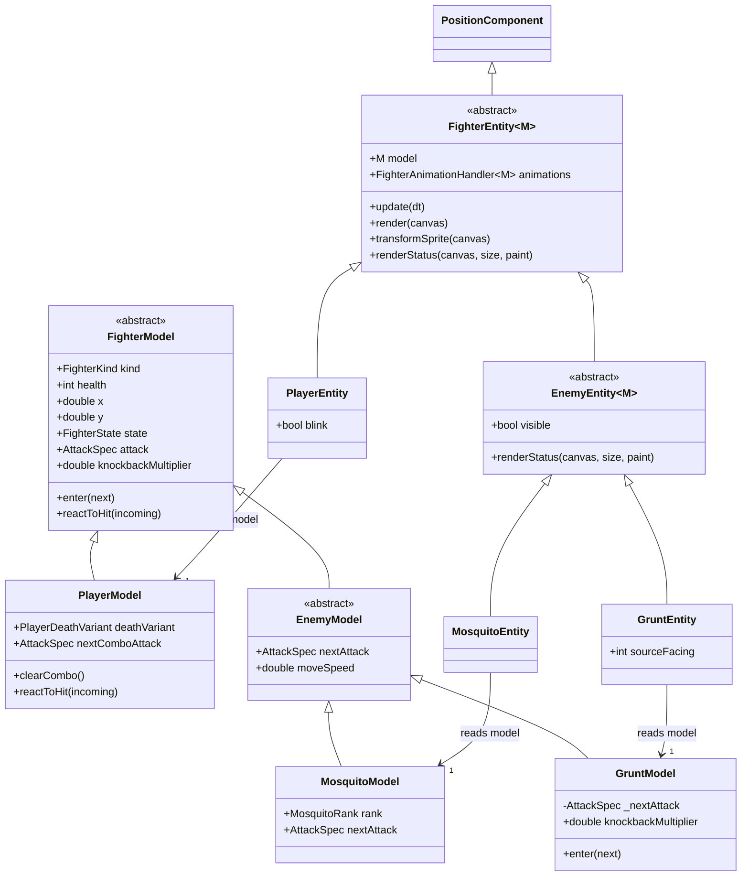
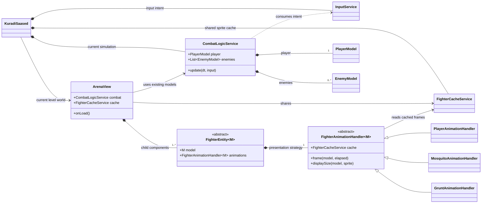
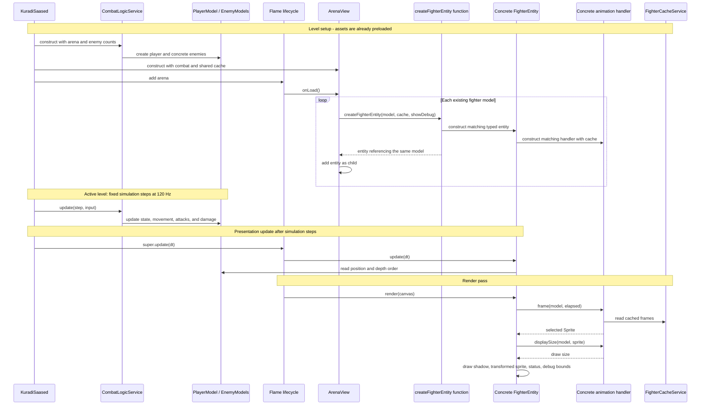

# Fighter arena: models, views, and animation

These Mermaid diagrams describe the implemented arena, not a proposed redesign.
They omit HUD, audio, scenery, and most combat fields to keep fighter ownership
readable. Update them when the hierarchy or arena composition changes.

## Browser page

The [retro HTML edition](../web/fighter-arena.html) contains all three diagrams,
zoom/fit controls, optional class members, SVG downloads, and the Mermaid sources.
While the web game is running, open `fighter-arena.html` relative to its base URL
(for example `http://localhost:8080/fighter-arena.html`). It is a documentation
page outside the game's menu. Rebuild an existing web release to include updates.
The HTML embeds its font, CSS, diagrams, and controls, so it also works offline.

This Markdown file remains the source of truth. To regenerate the HTML after
editing a diagram, use a current Node.js executable and Pele 1.6.0:

```powershell
node tool/render_fighter_arena.mjs C:\path\to\pele.mjs
```

If `pele` is installed locally, omit the module path. The renderer reads the three
Mermaid blocks below and `tool/fighter-arena-template.html`, reuses the embedded
font from the existing combat guide template, and writes `web/fighter-arena.html`.
Compact class views omit member lists for readability; the Members checkbox
reveals the full source diagram. Check all three tabs, member toggles, zoom/fit,
source disclosure, and narrow layouts after regeneration.

The colors, pixel typography, hard borders, and optional scanlines adapt the
existing combat guide and [alienretro.dev](https://alienretro.dev/) styling.

## Fighter models and entities

The simulation owns the models. Each entity holds a reference to its matching
model; creating an entity does not create a second model. `M` is a Dart generic
type parameter constrained to `FighterModel`.



`FighterKind` is the enum `player`, `mosquito`, `grunt`. It identifies a category;
the concrete model/entity classes own the differences. Player combo state and
knockdown reactions live in `PlayerModel`; grunt attack alternation lives in
`GruntModel`. Grunts override incoming knockback to 25%. A mosquito's
`MosquitoRank` selects regular or faster veteran sting timing; level 2 randomly
promotes one small mosquito and level 3 promotes three. `MosquitoEntity` owns its yellow asterisk marker,
using the same model/entity/handler pairing. Presentation does not advance
combat phases.

The three model-reference arrows specialize the inherited `model` field. They
do not represent extra fields on the concrete entities. `EnemyEntity<M>` further
constrains `M` to `EnemyModel`.

## Runtime ownership and animation selection

`ArenaView` inherits Flame's `World`. Its child entities belong to the arena;
their models belong to the combat simulation. `FighterCacheService` is shared
across entities and is owned by the game, not by each individual handler.



| Entity | Model type `M` | Animation handler |
| --- | --- | --- |
| `PlayerEntity` | `PlayerModel` | `PlayerAnimationHandler` |
| `MosquitoEntity` | `MosquitoModel` | `MosquitoAnimationHandler` |
| `GruntEntity` | `GruntModel` | `GruntAnimationHandler` |

## Construction and frame flow

`createFighterEntity` is a top-level function in
`fighter_entity_factory.dart`, not another runtime class. It is the single
presentation boundary that switches over the sealed model subtypes.



Camera/viewport scaling is applied by Flame around the scene. It scales all
fighters together. The handler's draw size and an entity's component scale are
separate from the cache's prepared pixel resolution and original PNG dimensions.

## How to read and maintain this

- A hollow triangle (`<|--`) means inheritance.
- A filled diamond (`*--`) means lifecycle ownership/composition.
- A solid arrow (`-->`) means a held reference/association.
- A dotted arrow (`..>`) means a usage dependency.
- Sequence arrows show calls and data flow, not ownership. Reading a model from
  presentation must not be mistaken for changing combat state.
- When adding an enemy, connect its model, entity, animation handler, and factory
  case, then update these diagrams and the mapping table. Shared mechanics do
  not need new type checks in the renderer.

Source entrypoints:

- [Arena composition](../lib/game/states/arena/view/arena_view.dart)
- [Entity factory](../lib/game/states/arena/view/fighter_entity_factory.dart)
- [Shared entity](../lib/game/states/arena/view/fighter_entity.dart)
- [Models and library parts](../lib/game/states/arena/model/fighter_model.dart)
- [Animation handler abstraction](../lib/game/states/arena/handlers/fighter_animation_handler.dart)
- [Combat simulation](../lib/game/states/arena/services/combat_logic_service.dart)
- [Sprite cache](../lib/game/states/arena/services/fighter_cache_service.dart)
- [Game composition and update loop](../lib/kuradi_saased.dart)
